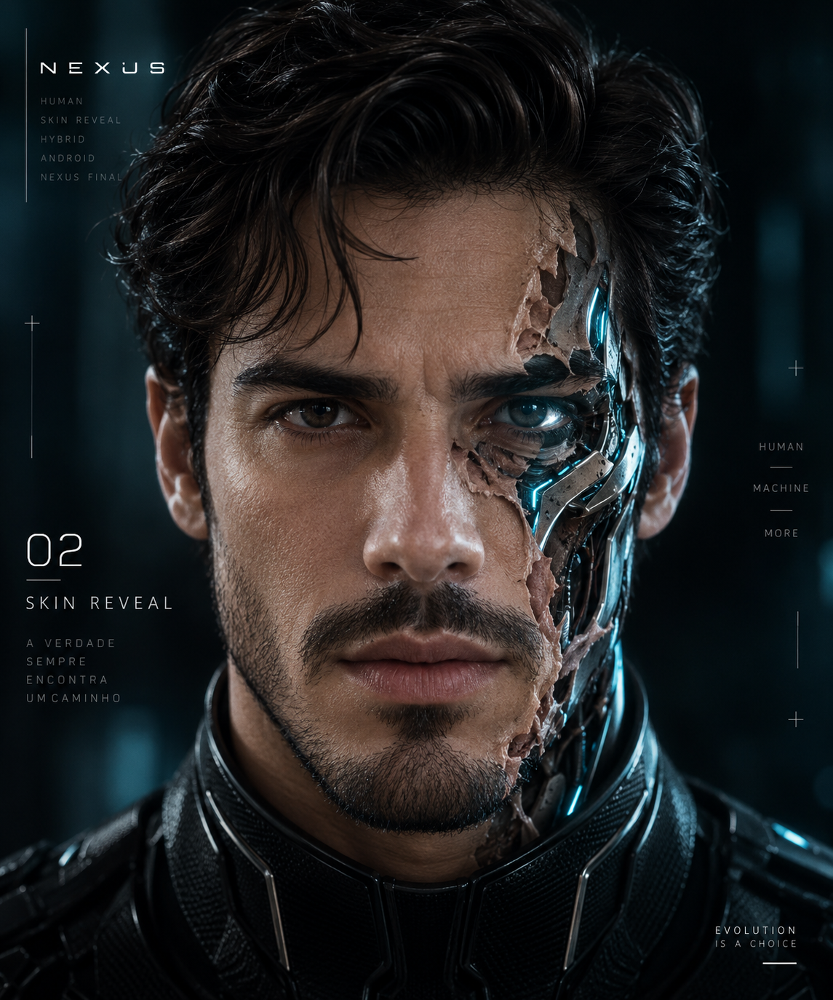
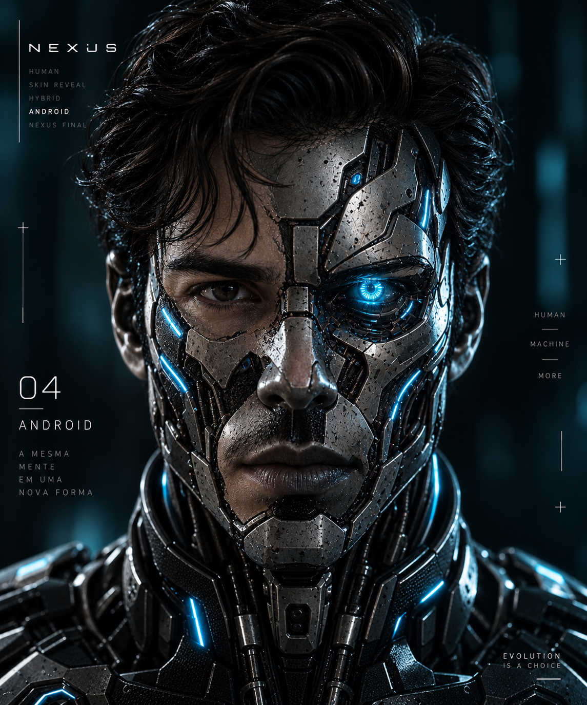

<div align="center">

# NEXUS

**Experiência cinematográfica em WebGL controlada pelo scroll: seis cenas que acompanham a transformação de um rosto humano em máquina e perguntam onde termina um e começa o outro.**






</div>

## A experiência

Não há seções HTML tradicionais: a página é um canvas 3D em tela cheia com cerca de 600vh de scroll, e o progresso do scroll dirige câmera, materiais, partículas e tipografia ao mesmo tempo.

| Cena | Scroll | O que acontece |
| --- | --- | --- |
| 01 · Human | 0–15% | a silhueta de um protagonista surge no escuro, com luz lateral fria e partículas |
| 02 · Beneath the skin | 15–32% | a pele dá lugar a wireframe e conchas biomecânicas |
| 03 · Machine | 32–50% | vista explodida: anéis, placas e componentes orbitando |
| 04 · The mind | 50–65% | as conchas se abrem e revelam o núcleo neural de partículas |
| 05 · Neural world | 65–88% | a câmera entra na rede sináptica, com pulsos elétricos e névoa volumétrica |
| 06 · Nexus | 88–100% | as partículas convergem na entidade final, metade humana, metade máquina |

## Destaques técnicos

- **React Three Fiber + drei + postprocessing**: cena declarativa em React, com bloom e efeitos de pós-processamento.
- **Câmera por keyframes** (`CameraRig`): posição e alvo interpolados a partir do progresso do scroll, sem saltos entre cenas.
- **Shader de dissolve próprio** (`NexusDissolveMaterial`): ruído procedural com borda emissiva e fresnel metálico, sincronizado por frame sem realocar uniforms.
- **Máquina de estados do personagem** (`characterStateMachine`): decide qual modelo e qual transição exibir em cada trecho da narrativa.
- **Carregamento resiliente de modelos GLB**: só ativa o caminho GLB quando os três modelos respondem; caso contrário usa a versão procedural, e um `ErrorBoundary` cai para `WebGLFallback` se o WebGL falhar.
- **Performance adaptativa**: `performanceDetector` classifica o dispositivo (núcleos, memória, mobile) e ajusta DPR, bloom e quantidade de partículas; dispositivos desconhecidos começam no perfil leve.
- **Acessibilidade de movimento**: respeita `prefers-reduced-motion`.
- **Gestão de memória de GPU**: geometrias, materiais e texturas são liberados no unmount para evitar vazamento de VRAM.
- **Scroll suave** com Lenis, animações de interface com GSAP e Framer Motion, estado global com Zustand e áudio de interface próprio (`nexusAudio`).

## Estrutura

```
src/
├── app/                     # App Router (layout e página única)
├── components/
│   ├── three/               # SceneCanvas, CameraRig, NexusCharacter, NeuralCore, NeuralWorld...
│   ├── ui/                  # HUD, navbar, overlays, cursor, fallback de WebGL
│   └── motion/              # SmoothScroll (Lenis)
├── data/scenes.ts           # roteiro das 6 cenas
├── lib/                     # máquina de estados, detector de performance, áudio
├── store/useStore.ts        # estado global (Zustand)
└── utils/nexusTransitions.ts
docs/                        # visão, design system, sistema 3D, motion e performance
```

A documentação de projeto em [`docs/`](docs) descreve a narrativa ([MASTER](docs/MASTER.md)), o sistema 3D ([THREE_SYSTEM](docs/THREE_SYSTEM.md)), o motion ([MOTION_SYSTEM](docs/MOTION_SYSTEM.md)), o design system ([DESIGN_SYSTEM](docs/DESIGN_SYSTEM.md)) e as metas de performance ([PERFORMANCE](docs/PERFORMANCE.md)).

## Como rodar

Requer Node.js 20.9 ou superior.

```bash
npm install
npm run dev      # http://localhost:3000
npm run build && npm start
npm run lint
```

## Autor

Lucas Santana · [LinkedIn](https://www.linkedin.com/in/lucas-santana-45316232a/)
