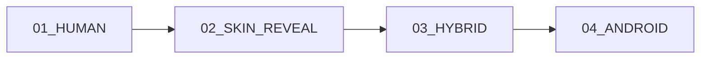

# CHARACTER BIBLE — PROTAGONISTA NEXUS

## 👤 VISÃO GERAL DO PROJETO E PERSONAGEM

- **Nome Oficial:** NEXUS
- **Arquétipo:** A Entidade Híbrida (A Fronteira entre Biologia e Inteligência Sintética)
- **Conceito Narrativo:** NEXUS não é um super-herói, um soldado cibernético ou um robô de combate. É uma entidade senciente nascida da convergência entre a consciência humana e a arquitetura computacional avançada. O design evoca autoridade intelectual, serenidade clínica e sofisticação biomecânica.
- **Pergunta Filosofica:** *"WHERE DOES HUMAN END AND MACHINE BEGIN?"*

---

## 🎨 LINGUAGEM DE DESIGN (DESIGN LANGUAGE)

A estética de NEXUS combina cinco pilares visuais fundamentais:

1. **Fotografia Editorial & Moda High-End:** Estrutura óssea marcante, olhar ereto e calmo, proporções equilibradas, ausência de feições grotescas ou exageradas.
2. **Engenharia Biomecânica de Precisão:** Componentes sintéticos que emulam tendões, fibras sintéticas e placas cranianas de alta tolerância, perfeitamente integrados à anatomia humana.
3. **Materiais Industriais Nobres:** Titânio escovado, cerâmica fosca preta, polímeros de carbono aeronáutico e fibras ópticas microscópicas.
4. **Laboratório de IA & Estética Clínica:** Luzes laterais frias de alta intensidade, sombras profundas e atmosfera cirúrgica minimalista.
5. **Accent Tecnológico Sutil:** Emissão luminosa ciano (`#00F0FF`) estritamente localizada em sulcos sinápticos e pupilas sintéticas.

---

## 🚫 ANTI-PATTERNS VISUAIS (O QUE NÃO FAZER)

- ❌ **Sem Armaduras Pesadas / Tanques:** Nenhuma placa robótica volumosa, Ombreiras gigantes ou visual militar.
- ❌ **Sem Estética Gamer / Neon Cyberpunk:** Sem luzes neon espalhas coloridas (vermelho, amarelo, roxo), grafites ou poluição visual.
- ❌ **Sem Cópias de Propriedades Intelectuais:** Não copiar Iron Man, Terminator (T-800), Cyborg (DC), Deus Ex ou Ghost in the Shell.
- ❌ **Sem Expressões Agressivas:** Sem dentes cerrados, cara de raiva ou feições de monstro. O olhar é sereno, pensativo e profundo.

---

## 🎨 PALETA DE MATERIAIS & CORES

| Elemento | Código / Cor | Textura & Acabamento |
| :--- | :--- | :--- |
| **Fundo Viewport** | `#050505` | Preto absoluto com névoa clínica sutil |
| **Pele Humana** | Eumelanina Natural Fria | Textura com poros reais, sutil refletividade cirúrgica |
| **Estrutura Interna** | Titânio Escuro (`#121417`) | Titânio anodizado, superfície jateada fosca |
| **Chassi / Placas** | Cerâmica Preita (`#0A0B0E`) | Cerâmica macia ao toque, anti-reflexo |
| **Elementos Ópticos** | Prata Fria (`#9CA8B6`) | Lentes micro-esféricas de safira sintética |
| **Accent Sináptico** | Ciano Sutil (`#00F0FF`) | Emissão luminescente em frestas microscópicas |

---

## 🎬 OS 4 ESTADOS OFICIAIS DE TRANSFORMAÇÃO (KEYFRAMES)

---

### ESTADO 01: `01_HUMAN` (Consciência Biológica Integrativa)

- **Descrição Geral:** O protagonista em sua forma biológica pura. Um jovem adulto de inteligência notável, olhar fixo, direto e profundamente calmo.
- **Rosto & Estrutura:** Feições andrógenas/masculinas equilibradas, maçãs do rosto proeminentes, simetria sutil, lábios neutros, pele impecável mas com porosidade natural realista.
- **Olhos:** Olhos humanos castanho-claros / acinzentados, profundamente expressivos, capturando a luz fria do estúdio.
- **Materiais:** Derme biológica com leve subsurface scattering (SSS) sob luz lateral fria.
- **Iluminação & Câmera:** Iluminação de estúdio clinical key-light lateral em 45°, sombras escuras e profundas no lado oposto. Câmera retrato close-up 85mm f/1.8.
- **Partes Mecânicas Visíveis:** 0% (Nenhum elemento sintético visível).

---

### ESTADO 02: `02_SKIN_REVEAL` (O Limiar da Dissolução)

- **Descrição Geral:** A camada epidérmica começa a dissolver-se em padrões geométricos cirúrgicos ao longo das têmporas e mandíbula, revelando a primeira camada biomecânica subjacente.
- **Rosto & Estrutura:** A expressão permanece serena. Uma fratura precisa e limpa da pele expõe o esqueleto interno sem aspecto sangrento, mas com acabamento tecnológico seco.
- **Olhos:** Olho esquerdo biológico puro; olho direito com sutil anel óptico de ajuste focal prateado na íris.
- **Materiais:** Borda da pele dissolvendo-se em micro-partículas térmicas; placas de cerâmica preta e fios de titânio emergindo debaixo da derme.
- **Iluminação & Câmera:** A luz lateral destaca a profundidade da fissura na pele. Câmera estática no mesmo enquadramento 85mm.
- **Partes Mecânicas Visíveis:** 25% (Apenas têmporas, pescoço lateral e arco zigomático direito).

---

### ESTADO 03: `03_HYBRID` (Convergência 50% Humano × 50% Máquina)

- **Descrição Geral:** O estado emblemático de NEXUS. Exatamente metade do rosto preserva a anatomia humana refinada, enquanto a outra metade revela uma engenharia biomecânica sofisticada.
- **Rosto & Estrutura:** Divisão vertical/diagonal perfeita. O lado mecânico re-escreve a anatomia facial com músculos sintéticos de fibra de carbono, canais sinápticos e placas articuladas de titânio escuro.
- **Olhos:** Olho humano à esquerda; olho sintético à direita com núcleo de vidro de safira e um micro-ponto de emissão ciano (`#00F0FF`).
- **Materiais:** Contraste extremo entre a calidez da pele natural e a frieza fosca da cerâmica e do titânio.
- **Iluminação & Câmera:** Luz fria de recorte dramático no lado mecânico, destacando reflexos nos sulcos de titânio.
- **Partes Mecânicas Visíveis:** 50% (Metade do crânio, pescoço e bochecha completamente sintéticos).

---

### ESTADO 04: `04_ANDROID` (Arquitetura Sintética Total)

- **Descrição Geral:** A transformação completa. O rosto biológico desapareceu por inteiro, dando lugar a uma escultura de engenharia andróide minimalista e refinada que ainda respeita a silhueta humana original.
- **Rosto & Estrutura:** Placas cerâmicas pretas e estruturas de titânio escuro montadas com tolerância zero. Sem bocas robóticas feias ou cavidades vazias; o rosto é um elipsoide escultural fluido.
- **Olhos:** Ambas as cavidades ópticas possuem sensores numéricos de alta resolução envoltos por um delicado aro ciano pulsante.
- **Materiais:** Titânio preto fosco jateado, micro-conectores folheados a prata e ranhuras guia de luz ciano.
- **Iluminação & Câmera:** Iluminação minimalista de contorno (Rim Lighting), projetando a silhueta perfeita do androide contra o fundo `#050505`.
- **Partes Mecânicas Visíveis:** 100% (Totalmente sintético e mecânico).
