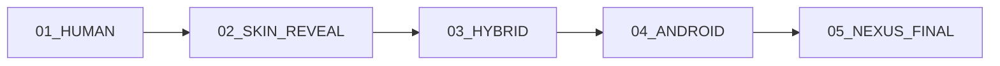

# CHARACTER BIBLE — PROTAGONISTA NEXUS

## 👤 VISÃO GERAL DO PROJETO E PERSONAGEM

- **Nome Oficial:** NEXUS
- **Arquétipo:** A Entidade Híbrida (A Fronteira entre Biologia e Inteligência Sintética)
- **Conceito Narrativo:** NEXUS representa a convergência final entre a consciência humana e a arquitetura computacional avançada.
- **Pergunta Filosófica:** *"WHERE DOES HUMAN END AND MACHINE BEGIN?"*

---

## 🎬 OS 5 ESTADOS OFICIAIS DE TRANSFORMAÇÃO (KEYFRAMES)

1. **`01_HUMAN` (Scroll: 0.00 → 0.15):** Forma biológica pura. Jovem adulto de olhar sereno, inteligente e direto.
2. **`02_SKIN_REVEAL` (Scroll: 0.15 → 0.32):** Fissura cirúrgica na pele expondo a primeira camada biomecânica subjacente.
3. **`03_HYBRID` (Scroll: 0.32 → 0.50):** Divisão 50% humano / 50% máquina com estrutura biomecânica e cerâmica fosca.
4. **`04_ANDROID` (Scroll: 0.50 → 0.88):** Estrutura sintética completa, placas de titânio escuro e imersão no núcleo neural.
5. **`05_NEXUS_FINAL` (Scroll: 0.88 → 1.00):** Convergência final das partículas neurais na entidade híbrida renascida. O limiar entre humano e máquina desaparece por completo.
