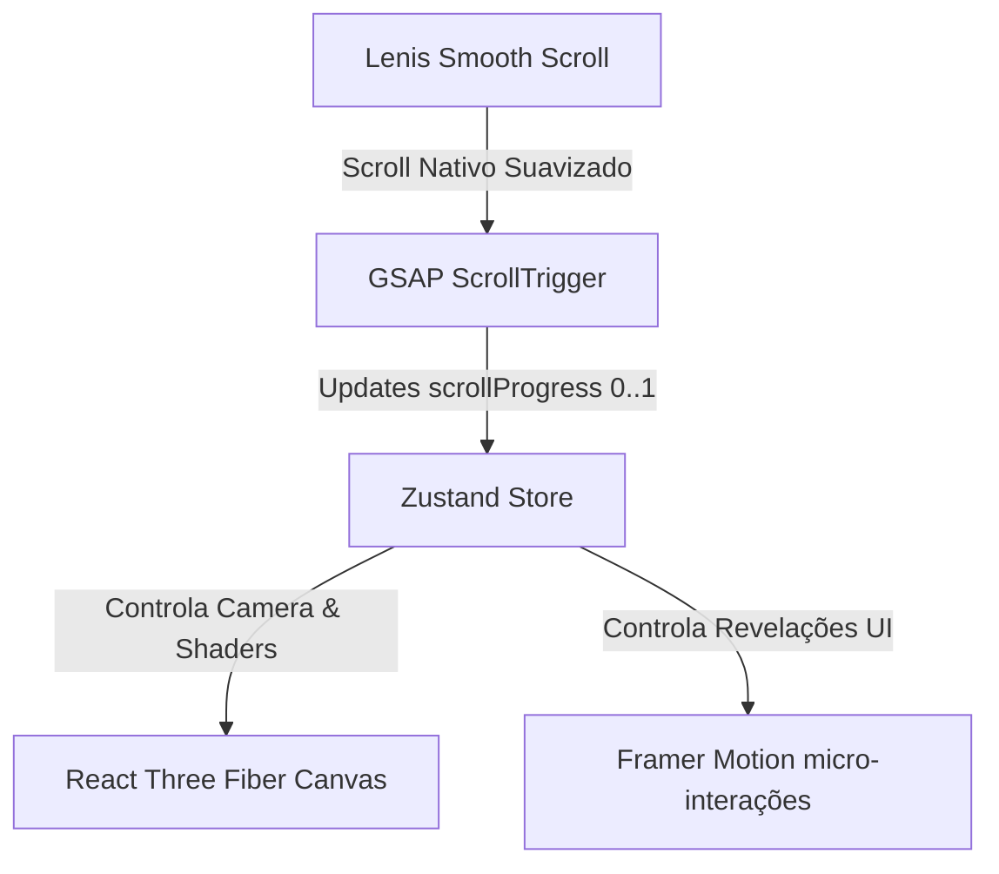

# MOTION_SYSTEM.md - Arquitetura de Movimento e Scroll

## 🎯 SEPARAÇÃO DE RESPONSABILIDADES EM ANIMAÇÃO

Para evitar conflitos de renderização, perda de performance e comportamentos erráticos no scroll, a stack de movimento obedece à seguinte divisão estrita:



### 1. 📜 Lenis Smooth Scroll
- **Papel:** Prover o scroll suavizado (inertial smooth scrolling) em todo o viewport.
- **Configuração:**
  - `duration`: 1.2s
  - `easing`: `(t) => Math.min(1, 1.001 - Math.pow(2, -10 * t))` (Expo Out)
  - Integrado diretamente ao RAF (RequestAnimationFrame) do GSAP.

### 2. ⚡ GSAP & GSAP ScrollTrigger
- **Papel:** Gerenciar a timeline mestre da experiência narrada.
- **Regras:**
  - O ScrollTrigger captura o progresso do elemento container de scroll (~300vh - 600vh).
  - Atualiza o valor `scrollProgress` (float de `0.000` a `1.000`) no Zustand store em tempo real.
  - Deve utilizar `scrub: true` ou `scrub: 0.5` para que o movimento pare exatamente quando o scroll parar.

### 3. ⚛️ Zustand Store (`useStore.ts`)
- **Papel:** Ponto único de verdade para o progresso do scroll e estado da cena.
- **Valores monitorados:**
  - `scrollProgress`: `number` (0 a 1)
  - `activeScene`: `'scene-01' | 'scene-02' | ...`
  - `isLoaded`: `boolean`
  - `devicePerformance`: `'high' | 'low' | 'mobile'`

### 4. 🎨 Framer Motion
- **Papel:** Exclusivamente para microinterações de interface 2D (buttons hover, fade de linhas HUD, entrada de textos secundários).
- **Proibição:** **NUNCA** utilizar Framer Motion para interpolar câmeras ou malhas dentro do Canvas Three.js.

---

## 📐 REGRA DE INTERPOLAÇÃO EM 3D (R3F LERP)

No loop `useFrame` do Three.js, o progresso do scroll NUNCA deve ser atribuído diretamente à posição sem lerp, pois causa travamentos visuais. Sempre aplique lerp de aproximação suave:

```typescript
useFrame((state, delta) => {
  const targetProgress = useStore.getState().scrollProgress;
  // Interpolador lerp para rotação e posição
  meshRef.current.rotation.y = THREE.MathUtils.lerp(
    meshRef.current.rotation.y,
    targetProgress * Math.PI * 4,
    delta * 4
  );
});
```
