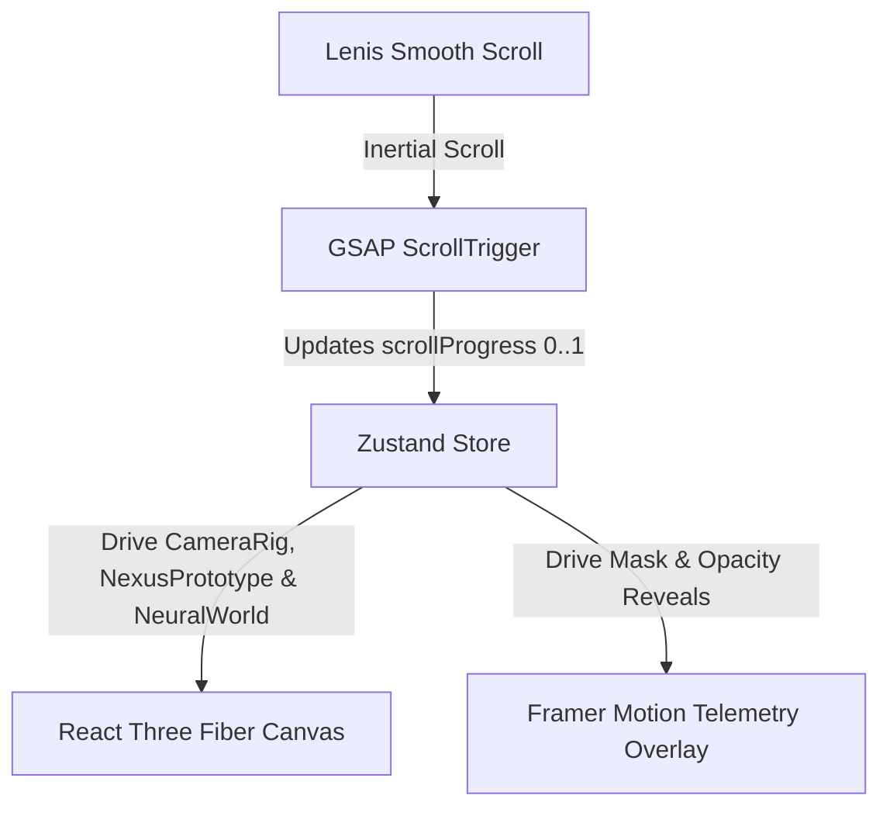

# MOTION_SYSTEM.md - Movimento e Arquitetura de Scroll NEXUS

## 📜 ARQUITETURA DE TIMELINE DA EXPERIÊNCIA (~600VH)

A experiência é estendida para **~600vh** de altura de scroll virtual, permitindo que cada uma das 6 Cenas ocupe um espaço calmo e cinematográfico no progresso global (0.00 a 1.00).

### Regras de Movimento:
1. **Lenis Smooth Scroll:** Duração 1.4s, curva exponencial out suave para peso cinematográfico.
2. **GSAP ScrollTrigger:** Atualiza o estado `scrollProgress` em tempo real sem re-renderizar componentes React desnecessários.
3. **Lerp em R3F Loop (`useFrame`):** A Câmera e o Protagonista usam lerp linear com fator `delta * 3.5` para evitar saltos secos de posição.
4. **Framer Motion:** Reservado estritamente para entrada/saída de microtextos de UI (`clip-path`, `opacity`, `translateY`).
